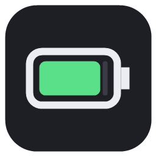
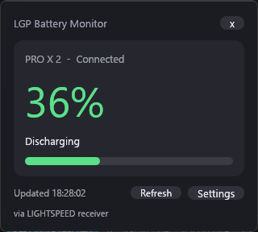
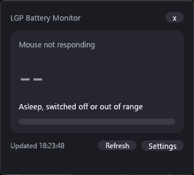
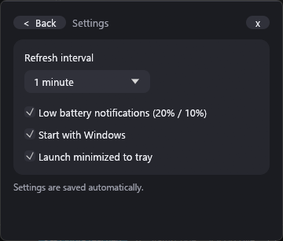
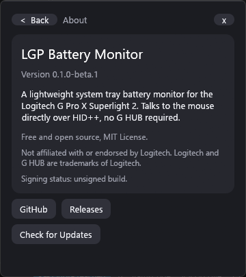
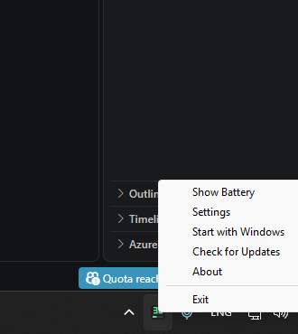
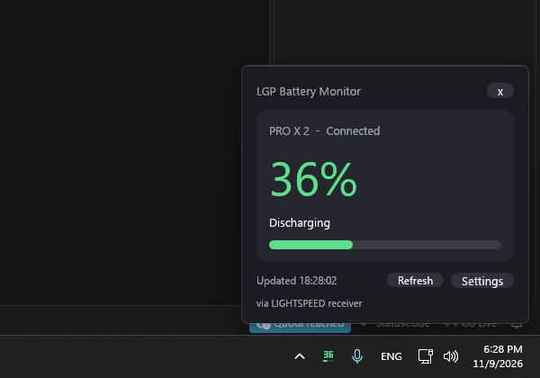
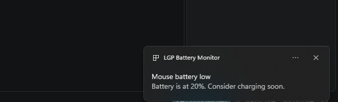

<p align="center">
  
</p>

<h1 align="center">LGP Battery Monitor</h1>

<p align="center">
  A lightweight Windows system tray battery monitor for the Logitech G Pro X Superlight 2.<br>
  Reads the battery straight from the mouse over HID++ — Logitech G HUB does not need to be running.
</p>

<p align="center">
  <a href="https://github.com/pzxe/LGP-Battery-Monitor/releases"></a>
  <a href="LICENSE"></a>
  
</p>

> **Beta software.** Verified on one setup only: a G Pro X Superlight 2 behind a LIGHTSPEED receiver on Windows 11. See [Supported devices](#supported-devices) and [Known limitations](#known-limitations). Not affiliated with or endorsed by Logitech.

## Screenshots

All screenshots are real captures of the running application (`scripts/capture.ps1`) on the developer's machine.

| Battery popup | Mouse asleep / not responding |
|:--:|:--:|
|  |  |

| Settings | About |
|:--:|:--:|
|  |  |

| Tray context menu | Running on the desktop |
|:--:|:--:|
|  |  |

Sample low-battery toast (triggered with `--test-notification`; the battery was not actually low):



## Features

- Real battery percentage from the mouse (HID++ 2.0 *Unified Battery* `0x1004`, falling back to *Battery Status* `0x1000`).
- Charging state shown only when the device reports it; otherwise "Charging status unavailable". Values are never guessed.
- Connection state, last-updated time, and a clearly labelled "last known" value while the mouse sleeps.
- Tray icon that draws the current percentage, with tooltip and context menu: **Show Battery, Settings, Start with Windows, Check for Updates, About, Exit**.
- Compact dark flyout popup that closes when it loses focus.
- Automatic refresh (30 s – 5 min, default 60 s); retries every 15 s while the mouse is not responding.
- Low (20 %) and critical (10 %) notifications, de-duplicated and re-armed after charging.
- Optional start with Windows (per-user registry key, no administrator rights), launch minimized to tray.
- Single instance: launching it again opens the popup of the running copy.
- Works over the LIGHTSPEED receiver and (by design, **unverified**) over the USB cable.
- Portable `.exe` (~5.5 MB) and a per-user installer.

## Download and install

Get the files from the [**Releases** page](https://github.com/pzxe/LGP-Battery-Monitor/releases):

- `LGP-Battery-Monitor-<version>-setup.exe` — installer (per-user, no admin needed; optional autostart and desktop shortcut).
- `LGP-Battery-Monitor-<version>-portable-x64.exe` — single file, just run it.
- `SHA256SUMS.txt` — verify with `Get-FileHash <file> -Algorithm SHA256`.

**The builds are not code-signed**, so Windows SmartScreen may show "Windows protected your PC" (click *More info → Run anyway* after checking the checksum). See [Code signing](#code-signing).

## Usage

1. Start the app. A tray icon appears (Windows 11 may place it under the **^ hidden icons** arrow — drag it onto the taskbar to keep it visible).
2. **Left-click** the icon for the battery popup; **right-click** for the menu.
3. Open **Settings** to change the refresh interval, notifications, autostart, and minimized launch.
4. Command line: `--show` (open popup), `--page settings|about`, `--probe` (print one reading), `--debug` (write `%APPDATA%\LGP Battery Monitor\debug.log`), `--version`.

## System requirements

- Windows 10 or Windows 11, x64
- A GPU/driver with OpenGL 2.0+ (used by the UI toolkit; any normal desktop GPU)
- A Logitech receiver or the mouse's USB cable
- No administrator rights, no Logitech G HUB

Footprint measured on the release build, popup hidden: ~80 MB working set, 0.00 s CPU over 40 s (most of the memory is the OpenGL context of the UI toolkit).

## Supported devices

| Device | Connection | Status |
|---|---|---|
| Logitech G Pro X Superlight 2 (reports itself as `PRO X 2`) | LIGHTSPEED receiver (`046D:C54D`) | **Verified** — percentage and discharging state read successfully on Windows 11 (not cross-checked against G HUB) |
| Logitech G Pro X Superlight 2 | USB charging cable | Implemented, **not verified** |
| Other Logitech HID++ 2.0 devices exposing `0x1004` / `0x1000` | receiver / cable | Likely to work, **not verified** — reports welcome |

## How battery communication works

1. Enumerate Logitech (`VID 0x046D`) HID interfaces with vendor usage page `0xFF00`, usage `0x0002` (HID++ long reports, ID `0x11`).
2. For the cable (`0xFF`) and receiver slots `1–6`, ping with Root `GetProtocolVersion`; a reply with major version ≥ 2 means a live HID++ 2.0 device.
3. Look up feature `0x1004` (Unified Battery) — read capabilities, then `GetStatus` → state of charge %, charging status — or `0x1000` (Battery Status) as a fallback. Device name/type come from feature `0x0005`.
4. A sleeping or switched-off mouse simply does not answer. That is shown as "Mouse not responding" and never as a made-up value.

All requests are read-only. The protocol was implemented from public HID++ documentation; no code was copied from other projects.

## Build from source

```powershell
winget install Rustlang.Rustup                # Rust (stable, MSVC)
# Visual Studio Build Tools with "Desktop development with C++" must be installed
git clone https://github.com/pzxe/LGP-Battery-Monitor
cd LGP-Battery-Monitor
cargo build --release                         # target\release\lgp-battery-monitor.exe
```

Installer (optional): `winget install JRSoftware.InnoSetup`, then
`ISCC /DAppVersion=0.1.0-beta.1 installer\lgp-battery-monitor.iss` → `dist\`.

### Development environment used for this release

Windows 11 Pro, Rust 1.99.1 (`stable-x86_64-pc-windows-msvc`), Visual Studio Build Tools 2019 (MSVC), Inno Setup 6.7.3, GitHub CLI.

## Testing

```powershell
cargo fmt --check
cargo clippy --all-targets -- -D warnings
cargo test
```

Unit tests cover HID++ framing/parsing, notification de-duplication, settings, version comparison and icon rendering; `tests/cli.rs` runs the built executable. Real-hardware checks are manual (`--probe`, popup, tray); see [CHANGELOG](CHANGELOG.md) and the release notes for what was verified.

## Troubleshooting

- **"Mouse not responding"** — the mouse is asleep (it sleeps after a short idle time) or off. Move it; the app re-checks every 15 s.
- **"No device found"** — receiver not plugged in, or another program has exclusive access to the HID interface.
- **No tray icon** — look under the hidden-icons arrow; drag the icon out to pin it.
- **No notifications** — check Windows Focus Assist / notification settings for "LGP Battery Monitor".
- Run `lgp-battery-monitor.exe --probe` in a terminal, or start with `--debug`, and attach the output to an issue.

## Known limitations

- Verified only with a Superlight 2 on a LIGHTSPEED receiver; cable mode and other mice are untested.
- While the mouse sleeps its battery cannot be read; the last known value is shown, labelled as such.
- Windows 10 and the notification/startup features were not tested on a separate Windows 10 machine.
- The UI toolkit (egui/OpenGL) costs ~80 MB RAM even when hidden.
- Update check is manual and only lists GitHub Releases; it does not download or install.
- Builds are unsigned.

## FAQ

**Does it need G HUB?** No. Battery reads succeeded on the test machine while G HUB processes were running; behavior without G HUB installed was not separately tested.
**Does it send data anywhere?** Only when you click *Check for Updates* (one HTTPS request to the GitHub API). No telemetry.
**Can it change my mouse settings?** No — it only sends battery queries.

## Code signing

**Status: not signed.** Releases are published unsigned with SHA256 checksums. A free certificate through the [SignPath Foundation](https://signpath.org/) open-source programme is the planned route; it needs an application and approval by the maintainer, and the release workflow contains a disabled, **untested** signing job. SmartScreen warnings may still appear even after signing until reputation builds. Details: [docs/code-signing.md](docs/code-signing.md).

## Security

See [SECURITY.md](SECURITY.md). Short version: read-only HID access, per-user registry only, no telemetry, network only on request.

## Contributing

See [CONTRIBUTING.md](CONTRIBUTING.md). Hardware reports for other devices are especially welcome.

## License

[MIT](LICENSE). Third-party crate licenses: [THIRD_PARTY_LICENSES.md](THIRD_PARTY_LICENSES.md). "Logitech", "G HUB" and "LIGHTSPEED" are trademarks of Logitech.

## Credits

- [egui / eframe](https://github.com/emilk/egui), [tray-icon](https://github.com/tauri-apps/tray-icon), [hidapi (Rust)](https://github.com/ruabmbua/hidapi-rs), [winreg](https://github.com/gentoo90/winreg-rs), [ureq](https://github.com/algesten/ureq), [tauri-winrt-notification](https://github.com/tauri-apps/winrt-notification), [chrono](https://github.com/chronotope/chrono), [serde](https://serde.rs/) — MIT/Apache-2.0 crates.
- Protocol knowledge comes from public HID++ 2.0 documentation and the community's reverse-engineering work, notably [Solaar](https://github.com/pwr-Solaar/Solaar) (GPL-2.0) and the Linux kernel `hid-logitech-hidpp` driver (GPL-2.0), consulted **as reference only; no code was copied**.
- Related open-source tray monitors surveyed for approach and compatibility notes (no code reused; licenses were only skimmed, not audited): [logibar](https://github.com/mryll/logibar), [logitray](https://github.com/ithilias/logitray), [LGSTrayBattery](https://github.com/vortex852456/LGSTrayBattery), [SuperLightBattery](https://github.com/Lken-cmd/SuperLightBattery). A project named "GPX Battery" could not be located during research.

Repository: <https://github.com/pzxe/LGP-Battery-Monitor> · Releases: <https://github.com/pzxe/LGP-Battery-Monitor/releases>
